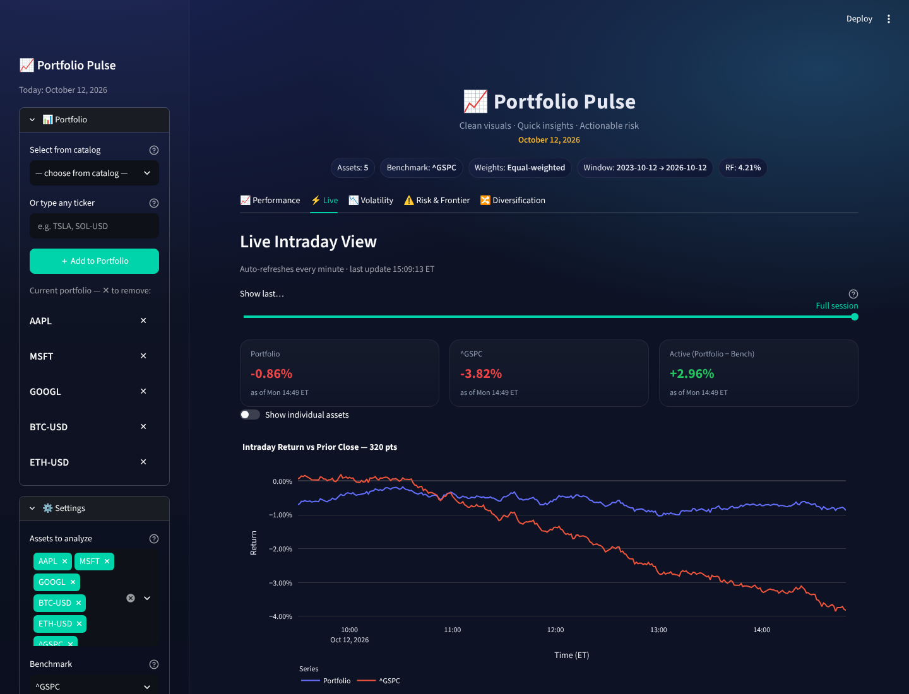

# 📈 Portfolio Pulse — Portfolio Risk & Return Dashboard

**Build a portfolio of stocks, ETFs, and crypto, and see its return, risk, and live performance on one interactive dashboard.**

[**▶ Live demo**](https://portfolio-pulse.onrender.com) · Python · Streamlit · pandas · NumPy · SciPy · Plotly · yfinance · Render

> The demo runs on Render's free tier, so the first load after a quiet period can take up to a minute while the server wakes up.


<sub>Live tab: portfolio vs S&P 500, minute by minute, measured from the prior close (screenshot uses simulated prices).</sub>

---

## Why I built it

Brokerage apps show you prices. They rarely answer the questions a portfolio manager asks: *How much risk am I taking for this return? Which holding drives most of my volatility? Is there a better mix of the same assets? How bad could tomorrow be?*

Portfolio Pulse answers those questions for any portfolio you build, using standard quantitative finance methods. Every formula is documented in [`docs/formulas.md`](docs/formulas.md).

## What it does

| Tab | What you get |
|---|---|
| **📈 Performance** | Annualised return and volatility; Sharpe, Sortino, Treynor and Calmar ratios; beta, tracking error and information ratio vs a benchmark; max drawdown; historical VaR / CVaR; growth-of-$1 chart and cumulative outperformance |
| **⚡ Live** | 1-minute portfolio vs benchmark return since the prior close. Refreshes every minute and works on weekends and overnight for mixed stock + crypto portfolios |
| **📉 Volatility** | Rolling annualised volatility and rolling beta with an adjustable window |
| **⚠️ Risk & Frontier** | Each asset's contribution to portfolio risk; efficient frontier with max-Sharpe, min-variance, equal-weight and your portfolio marked; Monte Carlo VaR & Expected Shortfall with adjustable confidence and horizon; covariance shrinkage |
| **🔀 Diversification** | Diversification ratio, correlation heatmap, sector and region allocation, per-asset metrics table, CSV downloads |

**Build any portfolio:** pick from 100+ stocks, ETFs and cryptocurrencies or type any Yahoo Finance ticker. Weight it equally, set custom weights, or let the optimiser choose **max-Sharpe** or **min-variance** weights. Analyse any window from the latest session up to 3 years, against any benchmark, with a live 10-year Treasury rate as the risk-free rate.

## Engineering highlights

- **Correct maths across mixed markets.** Crypto trades 365 days a year and stocks about 252. Naively mixing them turns every weekend into a fake 0% stock return and breaks annualisation. Prices are aligned to one trading calendar, so every metric uses a consistent 252-day basis.
- **Per-asset session logic for "today".** On a Saturday a stock's latest session is Friday while Bitcoin's is Saturday. In the evening, Yahoo's crypto bars have already rolled to the next UTC day. Each asset is measured from its own prior close, so the daily and live numbers always agree.
- **Portfolio optimisation.** Constrained mean-variance optimisation with SciPy's SLSQP solver: max-Sharpe, min-variance, and an efficient frontier traced from the min-variance point, with user-set weight bounds.
- **Risk modelling.** Historical and Monte Carlo (multivariate normal) VaR / Expected Shortfall, Euler risk contributions, and optional shrinkage of the covariance matrix toward its diagonal for stability.
- **Lean, reliable deployment.** A single Streamlit process fetches data on demand with caching (5 minutes for daily data, under a minute for intraday) and retries. It fits Render's free 512 MB instance with no background workers or persistent disk. The Live tab refreshes in place without re-running the whole dashboard.
- **Tested against edge cases.** End-to-end runs with simulated market data across market hours, pre-open, evenings, weekends, every time window and every weighting mode.

## Project structure

```
app/app.py              Streamlit UI: sidebar, tabs, charts, data fetching with caching
src/metrics_core.py     Returns, risk ratios, drawdown, beta/alpha, optimisers, frontier, VaR/ES
src/metrics_active.py   Latest-session and intraday returns across stock and crypto calendars
src/config.py           Benchmark, risk-free rate and refresh settings from config/portfolio.yaml
src/data_fetch.py       Optional CLI: snapshot 3-year history to Parquet
src/live.py             Optional CLI: 1-minute intraday cache to Parquet
docs/formulas.md        Every formula used, with notation and code references
render.yaml             One-click Render deployment (Blueprint)
```

## Run it locally

```bash
git clone https://github.com/Anou-shka/portfolio_risk_and_return_dashboard.git
cd portfolio_risk_and_return_dashboard
python -m venv .venv && source .venv/bin/activate     # Windows: .venv\Scripts\activate
pip install -r requirements.txt
bash scripts/start.sh                                 # or: streamlit run app/app.py
```

Then open http://localhost:8501.

<details>
<summary><b>Optional offline data tools</b></summary>

The app doesn't need these; they save data to Parquet for offline analysis.

```bash
python -m src.data_fetch init     # 3y daily history → data/processed/
python -m src.data_fetch update   # append the official daily bar after the close (--force off-hours)
python -m src.live daemon         # 1-minute cache → data/raw/intraday/ (US market hours)
```
</details>

## Deploy on Render

`render.yaml` is a ready Blueprint (free plan, Python 3.12). For a manually created service, set:

- **Build Command:** `pip install -r requirements.txt`
- **Start Command:** `bash scripts/start.sh`

| Environment variable | Purpose |
|---|---|
| `APP_ACCESS_CODE` | Optional password gate: visitors need the link **and** the code |
| `PP_VALIDATE_METRICS=1` | Optional: log a SPY-vs-QQQ metrics self-check once per session |

## Notes & limitations

- Market data comes from Yahoo Finance via `yfinance`. Yahoo sometimes rate-limits cloud servers; the app retries, then shows a clear message instead of failing.
- Monte Carlo VaR assumes normally distributed returns, which understates fat tails. Historical VaR is shown alongside it for comparison.
- For analysis and education only; not investment advice.
